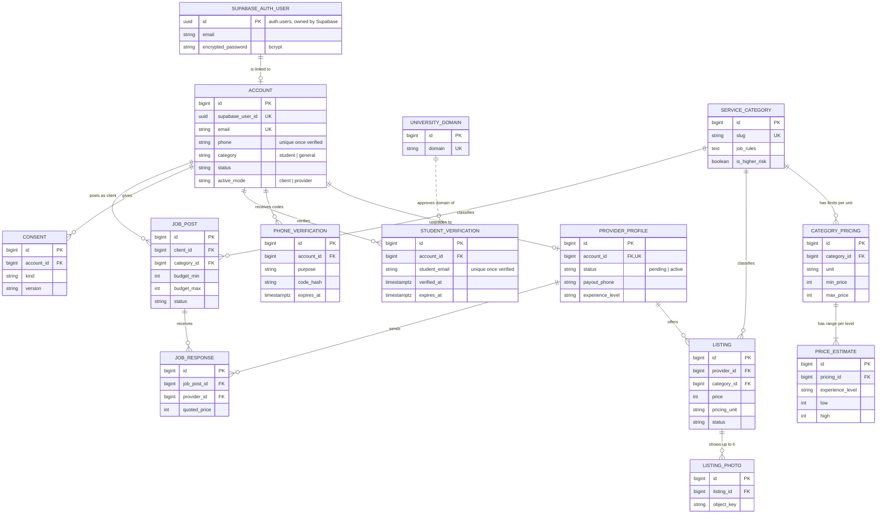
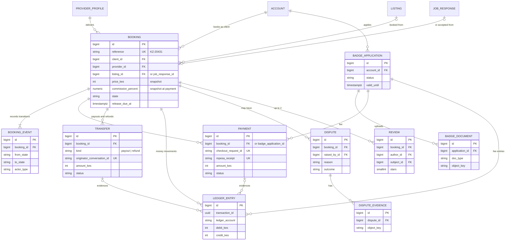
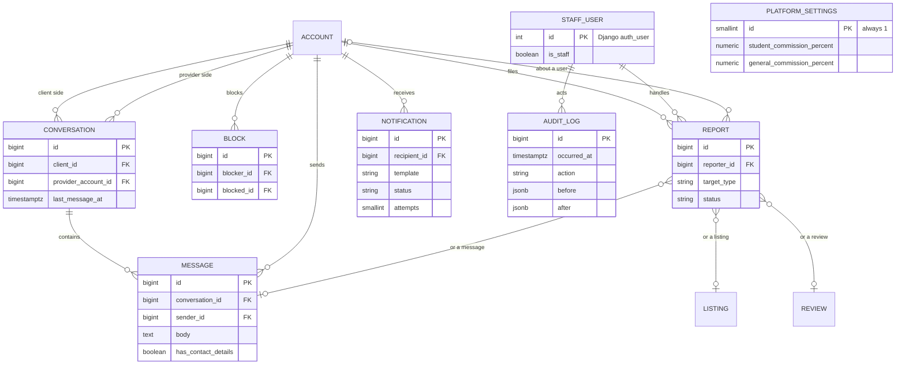

# Kazi Connect Database Design Document

**Status:** Working draft  
**Version:** 0.1 (2 November 2026)  
**Sources:** [SRS](./Kazi_Connect_SRS.docx) v1.0 section 4.6 and Figure 7; [System Design Document](./Kazi_Connect_SDD.md) v0.1  
**Database:** PostgreSQL 17, hosted by Supabase, managed through Django 5.2 migrations  
**Companion document:** [OOAD diagrams](./Kazi_Connect_OOAD_Diagrams.md)

## 1. Purpose and scope

This document describes how Kazi Connect stores its data: the tables, columns, keys, constraints, indexes, and the rules for security, retention, and change. It turns the SRS data requirements (section 4.6, Figure 7, Tables 43 and 44) into a relational schema.

It covers the whole system, at two levels of detail:

| Marker | Meaning |
|---|---|
| **Built** | The table exists in the MVP code (`backend/*/models.py`) and its migrations. The data dictionary matches the code exactly. |
| **Designed** | The table is planned for a later milestone. Its columns and rules are a design to be confirmed when that module is built. |

The SRS stays authoritative. Where this design differs from SRS Figure 7, section 3.2 says why.

## 2. Design decisions

| # | Decision | Reason |
|---|---|---|
| DB-1 | **Supabase Auth owns credentials.** `auth.users` (Supabase's schema) holds email, password hash and sessions. Kazi Connect's `accounts_account` row links to it through `supabase_user_id` (UUID, unique). There is no database foreign key into the `auth` schema. | SDD section 5.1. Django does not manage the `auth` schema, so a cross-schema foreign key would sit outside our migrations. The account deletion process (SR-F-PRV-03) removes both sides. |
| DB-2 | **Staff are separate from marketplace users.** Admins are Django `auth_user` rows. Marketplace users are `accounts_account` rows. | BRU-18 and SR-F-ACC-12: there is no public admin registration, and a user token must never imply staff access (SDD D-01). |
| DB-3 | **Surrogate `bigint` primary keys** (Django `BigAutoField`, a PostgreSQL identity column). | Simple, fast joins. Every API endpoint checks ownership, so guessable IDs do not expose data. Booking references shown to people (for example `KZ-20431`) are a separate unique column. |
| DB-4 | **Money is whole Kenya shillings in `integer` columns.** Percentages are `numeric(5,2)`. No floating-point money anywhere. | UR-NF-09 shows whole shillings; SR-F-PAY-08 rounds to whole shillings. Integers avoid rounding errors. `integer` holds amounts up to KES 2.1 billion. |
| DB-5 | **Enumerations are `varchar` columns with a `CHECK` constraint** (Django `TextChoices`). | Adding a value is one migration. PostgreSQL `ENUM` types are harder to change. The check stops bad values even if they bypass Django. |
| DB-6 | **All times are `timestamptz`, stored in UTC.** The interface shows East Africa Time. | SR-NF-AUD-03. |
| DB-7 | **States, not deletes.** Listings and job posts move to `removed`; accounts move to `deactivated`. Financial, ledger, dispute and audit rows are never deleted inside their retention period. | Bookings, reviews and the ledger must keep pointing at what they referred to. Retention rules (section 8) decide when data is finally deleted or anonymised. |
| DB-8 | **Bookings copy the terms that applied when they were made:** price, commission rate, provider category, job rules and provider terms. | BRU-07 and SR-F-LST-04: later setting or price changes must not change an existing booking. |
| DB-9 | **The ledger and the audit log are append-only**, enforced in the database by a trigger and by revoking `UPDATE` and `DELETE`. | SR-F-PAY-06 and SR-NF-AUD-02. Corrections are new entries. |
| DB-10 | **Derived values are cached on the provider profile** (experience level, average rating, completed jobs, recommendation score) and recomputed by service code and a daily job. | Search must answer within 2 seconds (SR-NF-PER-02) without aggregating reviews on every query. SR-F-REC-03 lists when to recompute. |
| DB-11 | **Secrets are stored hashed.** Phone codes are HMAC-SHA256 with the server secret; email link tokens are SHA-256. The plain values exist only in the SMS or email. | A database leak must not reveal usable codes or links. |
| DB-12 | **Files are not stored in the database.** Tables hold a private storage object key plus type, size and lifecycle dates. | SDD section 5.3 and SR-NF-SEC-05. Files live in private Supabase Storage (decision D-02). |
| DB-13 | **Django migrations are the single source of truth** for the schema. No manual changes in the Supabase dashboard. | Repeatable environments (SR-NF-MNT-01). Section 9. |

## 3. Entity-relationship model

### 3.1 Diagrams

The model is split into three diagrams so each stays readable. Only keys and the most important columns are shown; section 4 lists every column.

**Diagram A: accounts, catalogue and job requests.** All of these tables are **Built** except `LISTING_PHOTO` and `JOB_RESPONSE`.



**Diagram B: bookings, money, disputes and reviews.** All **Designed**.



**Diagram C: messaging, safety, notifications and audit.** `PLATFORM_SETTINGS` is **Built**; the rest are **Designed**.



### 3.2 Differences from SRS Figure 7

| Figure 7 | This design | Why |
|---|---|---|
| `User` with `password_hash`, `has_provider_role` | `accounts_account` without a password; provider role is the existence and status of `accounts_providerprofile` | Passwords stay in Supabase Auth (DB-1). The SRS needs a Pending provider state (SR-F-ACC-09), which a boolean cannot express. |
| `Booking` 1 to 0..1 `Payment` | 1 to many `payments_payment`, at most one `succeeded` | SR-F-PAY-03 allows up to 3 retries. Each STK Push attempt has its own `CheckoutRequestID`, which must be stored to handle callbacks once (SR-F-PAY-05). |
| `Message.conversation_id` with no conversation entity | `chat_conversation` table | SR-F-CHT-01 needs one conversation per client and provider pair, with unread counts and digest timing. |
| `ServiceCategory.estimate_min, estimate_max` | `listings_categorypricing` (limits per unit) and `listings_priceestimate` (range per experience level) | SR-F-PRC-01 sets limits per category **and** pricing unit; SR-F-PRC-03 adjusts the estimate by experience level, as the Figma listing editor shows. |
| Not shown | `accounts_phoneverification`, `accounts_universitydomain`, `accounts_consent`, `core_platformsettings`, `bookings_bookingevent`, `payments_transfer`, `payments_ledgerentry`, `reports`, `notifications`, `audit_log` | Supporting entities from SRS Table 43, or needed to meet a specific requirement (cited per table in section 4). |
| Not in the SRS | `jobs_jobpost`, `jobs_jobresponse` | Change request CR-01 (section 11). |

## 4. Data dictionary

Column types are the PostgreSQL types Django 5.2 creates. `PositiveIntegerField` columns also get an automatic `CHECK (col >= 0)`. Foreign keys are `DEFERRABLE INITIALLY DEFERRED` and indexed. Django 5.2 applies `on_delete` behaviour in Python, not in the database, so the "On delete" notes describe application behaviour.

### 4.1 Accounts and access (`accounts` app)

#### `accounts_account` — Built

A Kazi Connect user (SRS "User"). Created after Supabase sign-up, when the user confirms their details (SR-F-ACC-01).

| Column | Type | Null | Notes |
|---|---|---|---|
| `id` | bigint identity | no | Primary key |
| `supabase_user_id` | uuid | no | Unique. Equals `auth.users.id`. Not editable. |
| `full_name` | varchar(120) | no | |
| `email` | varchar(254) | no | Unique, lower case. Copied from the verified Supabase identity. |
| `email_verified_at` | timestamptz | yes | Set at creation: Supabase only issues a session after email confirmation. |
| `phone` | varchar(13) | no | Kenyan mobile in E.164 form, `+2547XXXXXXXX` or `+2541XXXXXXXX` |
| `phone_verified_at` | timestamptz | yes | Set by a correct SMS code (SR-F-ACC-03) |
| `category` | varchar(10) | no | `student` or `general`; default `general` (BRU-04) |
| `status` | varchar(20) | no | `pending_verification`, `active`, `suspended`, `banned`, `deactivated` (SR-F-ACC-13) |
| `active_mode` | varchar(10) | no | `client` (shown as Hiring) or `provider` (Working). Interface only; never used for authorisation. |
| `created_at`, `updated_at` | timestamptz | no | |

Constraints:

- `account_verified_phone_unique`: `UNIQUE (phone) WHERE phone_verified_at IS NOT NULL`. A phone number belongs to one account (SR-F-ACC-04), but only verified numbers count, so nobody can block someone else's number by typing it into a sign-up form.
- `account_category_valid`, `account_status_valid`, `account_mode_valid`: `CHECK (col IN (...))`.

#### `accounts_providerprofile` — Built

Created when a client starts the provider upgrade (BRU-02). One per account.

| Column | Type | Null | Notes |
|---|---|---|---|
| `id` | bigint identity | no | |
| `account_id` | bigint | no | FK `accounts_account`, unique. On delete: cascade. |
| `status` | varchar(10) | no | `pending` until every SR-F-ACC-08 step is done, then `active` |
| `bio` | text | no | Empty string until written |
| `skills` | jsonb | no | Array of strings, at most 15 |
| `payout_phone` | varchar(13) | no | M-Pesa number for payouts; empty until entered |
| `payout_phone_verified_at` | timestamptz | yes | Step (b) |
| `category_confirmed_at` | timestamptz | yes | Step (c) |
| `experience_level` | varchar(12) | no | `entry`, `intermediate`, `experienced` (SR-F-PRC-02); default `entry` |
| `activated_at` | timestamptz | yes | When status became `active` |
| `created_at`, `updated_at` | timestamptz | no | |

Designed additions: `photo_object_key` (step a, waits for D-02), `average_rating numeric(3,2)`, `rating_count integer`, `completed_jobs integer`, `response_rate numeric(5,2)`, `cancellation_rate numeric(5,2)`, `upheld_disputes integer`, `has_badge boolean`, `badge_expires_at timestamptz`, `recommendation_score numeric(10,4)` with an index for ranking (SR-F-REC-01). Client-side ratings (SR-F-LST-06) get matching columns on `accounts_account`.

#### `accounts_phoneverification` — Built

One row per SMS code sent (SR-F-ACC-03). Used for the account phone and the payout number.

| Column | Type | Null | Notes |
|---|---|---|---|
| `id` | bigint identity | no | |
| `account_id` | bigint | no | FK `accounts_account`; cascade |
| `purpose` | varchar(20) | no | `account_phone` or `payout_phone` |
| `phone` | varchar(13) | no | Number the code was sent to |
| `code_hash` | varchar(64) | no | HMAC-SHA256 of phone and code (DB-11) |
| `expires_at` | timestamptz | no | 5 minutes after sending |
| `attempts` | smallint | no | Wrong and right tries; locked at 3 |
| `verified_at` | timestamptz | yes | Set when the right code is entered; the code is then used up |
| `created_at` | timestamptz | no | |

Index `phoneverif_phone_created_idx (phone, created_at)` serves the "at most 5 codes per number per hour" count.

#### `accounts_universitydomain` — Built

Email domains that prove Student status (SR-F-VER-01). Adding a campus is a new row, not a code change (BO-4, BR-NF-06).

| Column | Type | Null | Notes |
|---|---|---|---|
| `id` | bigint identity | no | |
| `domain` | varchar(100) | no | Unique, lower case. Seeded with `students.mmu.ac.ke` (to be confirmed, OI-03). |
| `university_name` | varchar(120) | no | |
| `is_active` | boolean | no | |
| `created_at` | timestamptz | no | |

#### `accounts_studentverification` — Built

A student email and the period its Student status lasts (SR-F-VER-01 to 07). One row per account and email; a yearly reverification updates the same row.

| Column | Type | Null | Notes |
|---|---|---|---|
| `id` | bigint identity | no | |
| `account_id` | bigint | no | FK `accounts_account`; cascade |
| `student_email` | varchar(254) | no | May differ from the sign-in email (SR-F-VER-02) |
| `token_hash` | varchar(64) | yes | SHA-256 of the emailed link token. Unique. Cleared when used (single use). |
| `link_expires_at` | timestamptz | yes | 24 hours after sending |
| `verified_at` | timestamptz | yes | |
| `expires_at` | timestamptz | yes | 12 months after `verified_at` (SR-F-VER-04) |
| `created_at`, `updated_at` | timestamptz | no | |

Constraints:

- `studentverif_account_email_unique`: `UNIQUE (account_id, student_email)`.
- `studentverif_verified_email_unique`: `UNIQUE (student_email) WHERE verified_at IS NOT NULL`. A verified student email belongs to one account (SR-F-VER-03).

When `expires_at` passes, a scheduled job sets `accounts_account.category` back to `general` (SR-F-VER-06). The service function exists (`expire_student_statuses`); the scheduler is decision D-04. Reminder emails (SR-F-VER-05) are tracked in `notifications_notification`.

#### `accounts_consent` — Built

Proof that a user accepted a legal text, at a version (SR-F-PRV-01, BR-NF-05, SR-F-ACC-08(d)).

| Column | Type | Null | Notes |
|---|---|---|---|
| `id` | bigint identity | no | |
| `account_id` | bigint | no | FK `accounts_account`; cascade |
| `kind` | varchar(20) | no | `terms`, `privacy`, `code_of_conduct`, `location` |
| `version` | varchar(20) | no | From the `LEGAL_DOCUMENT_VERSIONS` setting; currently `draft-2026-11` |
| `accepted_at` | timestamptz | no | |

`consent_once_per_version`: `UNIQUE (account_id, kind, version)`. When a text changes, its version changes, and users accept the new version. Designed addition: `withdrawn_at` for location consent, which users can withdraw.

### 4.2 Platform settings (`core` app)

#### `core_platformsettings` — Built

Admin-configurable values (SRS Appendix A). Always exactly one row.

| Column | Type | Null | Notes |
|---|---|---|---|
| `id` | bigint | no | Always 1 |
| `student_commission_percent` | numeric(5,2) | yes | Empty until admins set it (OI-01) |
| `general_commission_percent` | numeric(5,2) | yes | |
| `job_post_lifetime_days` | smallint | no | Default 30 (CR-01) |
| `updated_at` | timestamptz | no | |

Constraints: `platformsettings_single_row CHECK (id = 1)`; `platformsettings_student_rate_below_general CHECK (student_commission_percent < general_commission_percent)` enforces BRU-06 and SR-F-ADM-02 in the database itself; each rate `CHECK (... BETWEEN 0 AND 100)`.

Designed additions (SR-F-ADM-03): `badge_fee_kes`, `badge_validity_months`, `booking_response_hours` (24), `payment_window_hours` (2), `late_cancellation_hours` (24), `review_window_days` (14), `dispute_response_hours` (48), `appeal_window_days` (7), `experience_thresholds jsonb`, `score_weights jsonb`, `new_provider_boost_days` (30). The 48-hour auto-release and 12-month student validity are fixed by BRU-10 and BRU-05, so they are constants in code, not settings. Change history is kept in `audit_auditlog` (US-27).

### 4.3 Categories and listings (`listings` app)

#### `listings_servicecategory` — Built

| Column | Type | Null | Notes |
|---|---|---|---|
| `id` | bigint identity | no | |
| `name` | varchar(60) | no | Unique |
| `slug` | varchar(60) | no | Unique; used in URLs and filters |
| `description` | varchar(200) | no | |
| `job_rules` | text | no | One rule per line. Both parties accept them (BRU-13). |
| `is_higher_risk` | boolean | no | SR-F-BKG-08 |
| `requires_badge` | boolean | no | Blocks publishing without a verified badge (SR-F-LST-05) |
| `late_cancellation_fee_percent` | numeric(5,2) | no | Default 20 (Appendix A); `CHECK 0..100` |
| `is_active` | boolean | no | |
| `sort_order` | smallint | no | |

Seeded by migration `listings/0002_seed_categories.py` with the four Appendix B categories and their job rules.

#### `listings_categorypricing` — Built

The allowed price range for a category and pricing unit (SR-F-PRC-01).

| Column | Type | Null | Notes |
|---|---|---|---|
| `id` | bigint identity | no | |
| `category_id` | bigint | no | FK `listings_servicecategory`; cascade |
| `unit` | varchar(12) | no | `per_job`, `per_hour`, `per_session` |
| `min_price` | integer | no | KES; `CHECK (min_price >= 1)` |
| `max_price` | integer | no | KES; `CHECK (max_price >= min_price)` |

`categorypricing_one_per_unit`: `UNIQUE (category_id, unit)`. A listing whose category and unit have no row cannot be published.

#### `listings_priceestimate` — Built

The suggested range for one experience level (SR-F-PRC-03).

| Column | Type | Null | Notes |
|---|---|---|---|
| `id` | bigint identity | no | |
| `pricing_id` | bigint | no | FK `listings_categorypricing`; cascade |
| `experience_level` | varchar(12) | no | `entry`, `intermediate`, `experienced` |
| `low`, `high` | integer | no | KES; `CHECK (high >= low)` |

`priceestimate_one_per_level`: `UNIQUE (pricing_id, experience_level)`. The rule "the estimate lies inside the category limits" spans two tables, so Django model validation checks it, not a database constraint.

#### `listings_listing` — Built

A service a provider offers (SR-F-LST-02, 03).

| Column | Type | Null | Notes |
|---|---|---|---|
| `id` | bigint identity | no | |
| `provider_id` | bigint | no | FK `accounts_providerprofile`; protect (cannot delete a provider with listings) |
| `category_id` | bigint | no | FK `listings_servicecategory`; protect |
| `title` | varchar(100) | no | |
| `description` | text | no | At most 600 characters (API); at least 80 to publish |
| `price` | integer | no | KES; `CHECK (price >= 1)`. A change applies to new requests only (SR-F-LST-04). |
| `pricing_unit` | varchar(12) | no | `CHECK` against the three units |
| `area_name` | varchar(120) | no | Approximate base location shown to clients (SR-F-SRC-07) |
| `latitude`, `longitude` | numeric(9,6) | yes | Filled by the map picker (designed); never sent to clients |
| `radius_km` | smallint | no | `CHECK (radius_km BETWEEN 1 AND 50)` |
| `availability` | varchar(200) | no | Free text in the MVP |
| `provider_terms` | text | no | Optional; may add to the job rules but not weaken them |
| `status` | varchar(10) | no | `draft`, `published`, `paused`, `removed` |
| `published_at` | timestamptz | yes | |
| `created_at`, `updated_at` | timestamptz | no | |

Index `listing_status_category_idx (status, category_id)` serves browsing. Publishing rules (in `listings/services.py`): provider and account active, description at least 80 characters, base location set, price inside the category limits, and a badge if the category requires one. A published listing cannot be edited into a state that breaks these rules.

#### `listings_listingphoto` — Designed

| Column | Type | Notes |
|---|---|---|
| `id` | bigint identity | |
| `listing_id` | bigint | FK `listings_listing`; cascade |
| `object_key` | varchar(255) | Private storage key |
| `content_type`, `size_bytes` | varchar(50), integer | Checked before storage: JPG or PNG, at most 5 MB (SR-NF-SEC-09) |
| `position` | smallint | `CHECK (position BETWEEN 1 AND 6)`; `UNIQUE (listing_id, position)` |

### 4.4 Job requests (`jobs` app, change request CR-01)

#### `jobs_jobpost` — Built

Work a client needs done, which providers can browse.

| Column | Type | Null | Notes |
|---|---|---|---|
| `id` | bigint identity | no | |
| `client_id` | bigint | no | FK `accounts_account`; protect |
| `category_id` | bigint | no | FK `listings_servicecategory`; protect |
| `title` | varchar(100) | no | |
| `description` | text | no | 30 to 2,000 characters (API) |
| `budget_min`, `budget_max` | integer | no | KES for the whole job; `CHECK (budget_min >= 1)`, `CHECK (budget_max >= budget_min)` |
| `area_name` | varchar(120) | no | Approximate area only, never an address |
| `is_remote` | boolean | no | `CHECK (is_remote OR area_name <> '')` |
| `preferred_date` | date | yes | Not in the past (East Africa Time) |
| `job_rules_accepted_at` | timestamptz | no | The client accepted the category job rules when posting |
| `status` | varchar(10) | no | `open`, `closed`, `removed` (by an admin) |
| `expires_at` | timestamptz | no | `created + job_post_lifetime_days` |
| `closed_at` | timestamptz | yes | |
| `created_at`, `updated_at` | timestamptz | no | |

Index `jobpost_open_browse_idx (status, category_id, expires_at)` serves the provider job board, which shows only `open` posts that have not expired, from active clients. Providers see the client's first name, category label and join date, never contact details.

#### `jobs_jobresponse` — Designed (CR-01 phase 2)

A provider's reply to a job post. Accepting a response creates a booking, so job posts join the same protected payment flow as listings.

| Column | Type | Notes |
|---|---|---|
| `id` | bigint identity | |
| `job_post_id` | bigint | FK `jobs_jobpost` |
| `provider_id` | bigint | FK `accounts_providerprofile`; `UNIQUE (job_post_id, provider_id)` |
| `listing_id` | bigint, null | Optional listing the offer is based on |
| `message` | text | |
| `quoted_price_kes` | integer | Within the category limits |
| `status` | varchar(10) | `sent`, `withdrawn`, `accepted`, `declined` |
| `created_at`, `responded_at` | timestamptz | |

### 4.5 Bookings — Designed

#### `bookings_booking`

| Column | Type | Notes |
|---|---|---|
| `id` | bigint identity | |
| `reference` | varchar(12) | Unique human reference, for example `KZ-20431`; also the M-Pesa account reference |
| `client_id` | bigint | FK `accounts_account` |
| `provider_id` | bigint | FK `accounts_providerprofile`; `CHECK` that the provider's account is not the client |
| `listing_id`, `job_response_id` | bigint, null | `CHECK` exactly one is set |
| `category_id` | bigint | FK `listings_servicecategory` |
| `scheduled_start` | timestamptz | |
| `duration_minutes`, `quantity` | integer, null | SR-F-BKG-01 |
| `location_text`, `is_remote`, `notes` | text, boolean, text | Exact location is visible to the provider only after acceptance (SR-F-SRC-07) |
| `price_kes`, `pricing_unit` | integer, varchar(12) | Snapshot of the listing or accepted quote (DB-8) |
| `job_rules_snapshot`, `provider_terms_snapshot` | text | What both parties accepted |
| `client_accepted_rules_at`, `provider_accepted_rules_at` | timestamptz | BRU-13 |
| `commission_percent`, `provider_category` | numeric(5,2), varchar(10), null | Snapshot taken **at payment** (BRU-07) |
| `state` | varchar(20) | See section 6 of the OOAD document; values below |
| `response_due_at`, `payment_due_at`, `release_due_at`, `review_closes_at` | timestamptz, null | Deadlines for the scheduler (24 h, 2 h, 48 h, 14 days) |
| `accepted_at`, `paid_at`, `started_at`, `delivered_at`, `released_at`, `cancelled_at` | timestamptz, null | |
| `cancelled_by` | varchar(10), null | `client`, `provider`, `system`, `admin` |
| `created_at`, `updated_at` | timestamptz | |

`state` values (from SRS Figure 5): `requested`, `declined`, `expired`, `accepted`, `cancelled`, `paid`, `in_progress`, `delivered`, `disputed`, `released`, `refunded`, `completed`.

Indexes: `(client_id, state)`, `(provider_id, state)` for the separate client and provider booking lists (SR-F-ACC-11); partial indexes on each deadline, for example `(release_due_at) WHERE state = 'delivered'`, so the 5-minute scheduler sweep (SR-F-DLV-06) reads only due rows.

#### `bookings_bookingevent`

Every state change, with time and actor (SR-F-BKG-06). Append-only.

| Column | Type | Notes |
|---|---|---|
| `id` | bigint identity | |
| `booking_id` | bigint | FK `bookings_booking` |
| `from_state`, `to_state` | varchar(20) | Only transitions allowed by Figure 5 are written; enforced in the booking service |
| `actor_type` | varchar(10) | `client`, `provider`, `admin`, `system` |
| `actor_account_id`, `actor_staff_id` | bigint, integer, null | |
| `note` | text | |
| `created_at` | timestamptz | |

### 4.6 Payments and ledger — Designed

#### `payments_payment`

One row per M-Pesa STK Push attempt (SR-F-PAY-01 to 05).

| Column | Type | Notes |
|---|---|---|
| `id` | bigint identity | |
| `booking_id`, `badge_application_id` | bigint, null | `CHECK` exactly one is set |
| `phone` | varchar(13) | Number prompted |
| `amount_kes` | integer | `CHECK (amount_kes >= 1)` |
| `merchant_request_id` | varchar(64) | From Daraja |
| `checkout_request_id` | varchar(64) | **Unique.** A repeated callback with the same ID is ignored (SR-F-PAY-05). |
| `status` | varchar(12) | `initiated`, `succeeded`, `failed`, `cancelled`, `timed_out` |
| `result_code`, `result_desc` | integer, text | |
| `mpesa_receipt` | varchar(20), null | Unique |
| `paid_at` | timestamptz, null | Time reported by M-Pesa |
| `attempt_number` | smallint | `CHECK (attempt_number BETWEEN 1 AND 4)`: the first try plus 3 retries |
| `raw_callback` | jsonb | Kept for reconciliation (SR-F-PAY-12) |
| `created_at`, `updated_at` | timestamptz | |

`UNIQUE (booking_id) WHERE status = 'succeeded'`: a booking is paid once.

#### `payments_transfer`

A B2C payout to a provider or refund to a client (SR-F-PAY-09, 10).

| Column | Type | Notes |
|---|---|---|
| `id` | bigint identity | |
| `booking_id` | bigint | FK `bookings_booking` |
| `kind` | varchar(10) | `payout` or `refund` |
| `recipient_phone` | varchar(13) | Verified payout number, or the number that paid |
| `amount_kes` | integer | `CHECK (amount_kes >= 1)` |
| `originator_conversation_id` | varchar(64) | Unique; our idempotency key for Daraja |
| `conversation_id`, `mpesa_receipt` | varchar(64), varchar(20), null | |
| `status` | varchar(10) | `queued`, `sent`, `succeeded`, `failed` |
| `attempts` | smallint | Retried up to 3 times, then admins are alerted |
| `result_code`, `result_desc`, `raw_result` | integer, text, jsonb | |
| `completed_at`, `created_at`, `updated_at` | timestamptz | |

#### `payments_ledgerentry`

The immutable record of every money movement (SR-F-PAY-06), in **double-entry** form: each movement is a group of rows sharing a `transaction_id`, whose debits equal their credits.

| Column | Type | Notes |
|---|---|---|
| `id` | bigint identity | |
| `transaction_id` | uuid | Groups the rows of one movement |
| `entry_type` | varchar(24) | `hold`, `release`, `commission`, `refund`, `payout`, `badge_fee`, `late_cancellation_fee` |
| `ledger_account` | varchar(24) | `mpesa_clearing`, `held_funds`, `provider_payable`, `client_refundable`, `platform_revenue` |
| `debit_kes`, `credit_kes` | integer | `CHECK ((debit_kes > 0 AND credit_kes = 0) OR (credit_kes > 0 AND debit_kes = 0))` |
| `booking_id`, `badge_application_id` | bigint, null | |
| `payment_id`, `transfer_id` | bigint, null | The M-Pesa record that evidences the movement |
| `created_at` | timestamptz | |

Example: a KES 800 payment, released with 5% commission, writes `hold` (debit `mpesa_clearing` 800, credit `held_funds` 800), then `release` and `commission` (debit `held_funds` 800, credit `provider_payable` 760 and `platform_revenue` 40), then `payout` when B2C succeeds. A booking is settled when its `held_funds` balance is zero, which is how BO-3 ("no unaccounted funds") is checked.

Append-only enforcement:

```sql
create function forbid_change() returns trigger language plpgsql as $$
begin
  raise exception '% is append-only', tg_table_name;
end $$;

create trigger ledger_append_only before update or delete on payments_ledgerentry
  for each row execute function forbid_change();
revoke update, delete on payments_ledgerentry from public;
```

The same trigger protects `bookings_bookingevent` and `audit_auditlog`. Ledger rows are written in the same database transaction as the state change they record (SR-NF-REL-02).

### 4.7 Verified badge — Designed

#### `kyc_badgeapplication`

| Column | Type | Notes |
|---|---|---|
| `id` | bigint identity | |
| `account_id` | bigint | FK `accounts_account` |
| `status` | varchar(14) | `awaiting_fee`, `in_review`, `approved`, `rejected`, `expired` |
| `fee_kes` | integer | Fee shown and charged at the time (BR-NF-07) |
| `resubmission_of_id` | bigint, null | Free resubmission within 30 days (SR-F-KYC-06) |
| `submitted_at`, `decided_at` | timestamptz, null | |
| `decided_by_id` | integer, null | FK `auth_user` (staff) |
| `rejection_reason` | text | Emailed to the user (SR-F-KYC-05) |
| `valid_until` | timestamptz, null | 12 months after approval (SR-F-KYC-08) |
| `documents_deleted_at` | timestamptz, null | 30 days after the decision (SR-F-KYC-09) |
| `created_at` | timestamptz | |

#### `kyc_badgedocument`

| Column | Type | Notes |
|---|---|---|
| `id` | bigint identity | |
| `application_id` | bigint | FK `kyc_badgeapplication` |
| `doc_type` | varchar(20) | `national_id_front`, `national_id_back`, `student_id` |
| `object_key` | varchar(255), null | Private, encrypted storage; set to null when the file is deleted |
| `content_type`, `size_bytes` | varchar(50), integer | JPG, PNG or PDF; at most 5 MB (SR-F-KYC-03) |
| `uploaded_at`, `deleted_at` | timestamptz | |

Every view of a document writes an audit log row (SR-F-KYC-04).

### 4.8 Disputes and reviews — Designed

#### `disputes_dispute`

| Column | Type | Notes |
|---|---|---|
| `id` | bigint identity | |
| `booking_id` | bigint | FK `bookings_booking`. `UNIQUE (booking_id) WHERE status <> 'closed'`: one open dispute at a time. |
| `raised_by_id` | bigint | FK `accounts_account` |
| `reason` | varchar(20) | `not_delivered`, `poor_quality`, `incomplete`, `safety_concern`, `price_disagreement`, `other` (SR-F-DSP-02) |
| `description` | text | |
| `status` | varchar(16) | `awaiting_response`, `under_review`, `decided`, `appealed`, `closed` |
| `response_text`, `responded_at`, `response_due_at` | text, timestamptz | 48-hour response (SR-F-DSP-04) |
| `assigned_to_id`, `decided_by_id` | integer, null | FK `auth_user`. An appeal must be decided by a different admin (SR-F-DSP-09). |
| `outcome` | varchar(8), null | `release`, `refund`, `split` |
| `provider_share_kes`, `client_share_kes` | integer, null | `CHECK` they add up to the booking price; commission applies to the provider share only (SR-F-DSP-06) |
| `decision_reasons` | text | Required with a decision (SR-F-DSP-07) |
| `appeal_of_id` | bigint, null | Self-reference for the one allowed appeal |
| `decided_at`, `created_at` | timestamptz | |

`disputes_evidence`: `id`, `dispute_id`, `uploaded_by_id`, `object_key`, `content_type`, `size_bytes`, `created_at`; at most 5 files per party (SR-F-DSP-02).

#### `reviews_review`

| Column | Type | Notes |
|---|---|---|
| `id` | bigint identity | |
| `booking_id` | bigint | FK `bookings_booking`; `UNIQUE (booking_id, author_id)` (SR-F-REV-03) |
| `author_id`, `subject_id` | bigint | FK `accounts_account`; `CHECK (author_id <> subject_id)` |
| `direction` | varchar(20) | `client_to_provider` or `provider_to_client` |
| `stars` | smallint | `CHECK (stars BETWEEN 1 AND 5)` |
| `comment` | varchar(1000) | |
| `submitted_at`, `published_at` | timestamptz | Published when both are in, or after 14 days (SR-F-REV-04) |
| `hidden_at`, `hidden_reason`, `hidden_by_id` | | Admins hide, never edit (SR-F-REV-06) |

### 4.9 Messaging and safety — Designed

| Table | Key columns and rules |
|---|---|
| `chat_conversation` | `client_id`, `provider_account_id` (both FK `accounts_account`); `UNIQUE (client_id, provider_account_id)` (SR-F-CHT-01); `CHECK (client_id <> provider_account_id)`; `last_message_at`; per-side `last_read_at` for unread counts; `digest_sent_at` for the hourly email limit (SR-F-CHT-04) |
| `chat_message` | `conversation_id`, `sender_id`, `body text`, `attachment_object_key` (image, at most 5 MB), `has_contact_details boolean` (SR-F-CHT-05 notice), `sent_at`; index `(conversation_id, sent_at)` |
| `safety_block` | `blocker_id`, `blocked_id`; `UNIQUE (blocker_id, blocked_id)` (SR-F-CHT-06) |
| `safety_report` | `reporter_id`; exactly one of `reported_account_id`, `listing_id`, `message_id`, `review_id` (`CHECK` that one is set, so each target keeps a real foreign key); `category`, `description`, `status` (`open`, `upheld`, `dismissed`), `handled_by_id`, `handled_at`, `resolution_note`; index `(status, created_at)` for the admin queue (SR-F-SAF-02) |

### 4.10 Notifications and audit — Designed

| Table | Key columns and rules |
|---|---|
| `notifications_notification` | `recipient_id`, `template` (one per SR-F-NTF-02 event), `to_email`, `subject`, `status` (`queued`, `sent`, `failed`), `attempts` (`CHECK <= 4`: first send and 3 retries, SR-F-NTF-04), `last_error`, optional `booking_id`, `sent_at`, `created_at`; index `(status, created_at)` for the sender |
| `audit_auditlog` | `occurred_at`, `actor_type` (`staff`, `user`, `system`), `actor_staff_id`, `actor_account_id`, `action` (for example `settings.update`, `badge_document.view`, `chat.read_for_dispute`), `target_table`, `target_id`, `before jsonb`, `after jsonb`, `reason`, `ip_address inet`; append-only (DB-9); indexes `(target_table, target_id)` and `(occurred_at)` (SR-F-ADM-09, SR-NF-AUD-01) |

## 5. Integrity rules and where they are enforced

Rules are enforced in the database whenever a constraint can express them, because the database is the last line of defence. Rules that need several tables, the current time, or external calls live in the service layer (`*/services.py`), which runs inside database transactions.

| Rule | Source | Enforced by |
|---|---|---|
| One account per email; one account per verified phone | SR-F-ACC-04 | Unique and partial unique indexes on `accounts_account` |
| A verified student email belongs to one account | SR-F-VER-03 | Partial unique index on `accounts_studentverification` |
| Phone code: 5 minutes, 3 attempts, 5 per hour | SR-F-ACC-03 | `accounts.services` (row lock with `SELECT ... FOR UPDATE`; the attempt is saved before the error is returned) |
| Student rate lower than General rate | BRU-06 | `CHECK` on `core_platformsettings` |
| Price inside the category limits | SR-F-PRC-05 | `listings.services` (needs a lookup in another table) |
| Positive prices and budgets; maximum not below minimum | data quality | `CHECK` constraints |
| Job post has an area unless remote | CR-01 | `CHECK` on `jobs_jobpost` |
| Valid enumeration values | all | `CHECK (col IN (...))` |
| Provider becomes active only after all steps | SR-F-ACC-09 | `accounts.services.refresh_provider_status` |
| A callback is processed once | SR-F-PAY-05 | Unique `checkout_request_id` plus a transaction (designed) |
| Ledger and audit rows never change | SR-F-PAY-06, SR-NF-AUD-02 | Trigger and revoked privileges (designed) |
| Booking moves only along Figure 5 | SR-F-BKG-06 | Booking service with an allowed-transitions table, plus `bookings_bookingevent` (designed) |

## 6. Indexes and query patterns

| Query | Index |
|---|---|
| Find the account for a signed-in user (every request) | Unique index on `accounts_account.supabase_user_id` |
| Count recent codes for a phone | `phoneverif_phone_created_idx` |
| Public listings by category | `listing_status_category_idx` |
| Job board: open, unexpired posts by category | `jobpost_open_browse_idx` |
| A provider's own listings, a client's own job posts | Foreign key indexes on `provider_id`, `client_id` |
| Scheduler sweeps: unanswered requests, unpaid bookings, release windows, expiring students | Partial indexes on each deadline column (designed) |
| Location search: listings whose service area covers a point | **Open (D-07).** Recommended: enable PostGIS (available on Supabase), store `location geography(Point)` and search with `ST_DWithin` and a GiST index. The MVP keeps `latitude` and `longitude` columns, which a migration can convert. |

## 7. Security and privacy

### 7.1 Supabase Data API and row-level security

Django creates its tables in the `public` schema, and Supabase's Data API (PostgREST) exposes `public` to anyone holding the publishable key, which ships in the browser. Two things protect Kazi Connect's tables today; this was checked on the project on 1 November 2026:

1. The project's `ensure_rls` event trigger turns on row-level security for every new table, so all 22 tables (10 Django built-in, 12 Kazi Connect) have RLS enabled.
2. There are no RLS policies, so the `anon` and `authenticated` roles can read or write nothing. Django connects as the table owner, which bypasses RLS.

Recommended, because Django is the only intended data path (SDD section 6): **turn off the Data API** in the Supabase dashboard, or remove `public` from its exposed schemas. Re-check RLS after every migration that adds a table.

### 7.2 Database roles

Django currently connects as the `postgres` role through the session pooler. Before production, create a dedicated application role with only `SELECT`, `INSERT`, `UPDATE` and `DELETE` on application tables (and no `UPDATE` or `DELETE` on append-only tables). Keep the `postgres` role for migrations, run once per deployment (SDD section 8.2).

### 7.3 Personal data classification

| Class | Columns | Handling |
|---|---|---|
| Identity and contact | `full_name`, `email`, `phone`, `student_email`, `payout_phone` | Shown only to the owner and admins; job posts show first names only |
| Location | `area_name`, `latitude`, `longitude`, booking `location_text` | Clients see approximate areas only until a booking is accepted (SR-F-SRC-07); location access needs separate consent (SR-F-PRV-01) |
| Financial | payments, transfers, ledger | Kept 5 years; never anonymised inside that period |
| Sensitive documents | `kyc_badgedocument`, dispute evidence | Private storage with AES-256 encryption and 5-minute links (SR-NF-SEC-05); every access audited |
| Secrets | `code_hash`, `token_hash` | Hashed (DB-11); not shown in Django Admin |

The MVP collects only fields needed for the functions built so far (SR-F-PRV-04).

## 8. Retention and deletion

A daily retention job (decision D-04) applies the SRS Table 44 periods:

| Data | Period | Tables | Action |
|---|---|---|---|
| Identity document images | 30 days after the badge decision | `kyc_badgedocument` | Delete the file, set `object_key` to null and `deleted_at` |
| Badge decision records | While the account exists, plus 12 months | `kyc_badgeapplication` | Delete |
| Chat messages | 12 months after the last booking between the parties | `chat_message`, `chat_conversation` | Delete |
| Payment, transfer and ledger records | 5 years, or as tax law requires | `payments_*` | Keep; then delete in order of dependency |
| Dispute records and evidence | 2 years after the decision | `disputes_*` | Delete files and rows |
| Audit log | At least 12 months | `audit_auditlog` | Delete rows older than the chosen period |
| Account after a deletion request | Within 30 days, except financial records | `accounts_*`, `jobs_jobpost`, listings, reviews | Delete the Supabase user; anonymise the `accounts_account` row (name, email, phone replaced) where bookings or ledger rows still refer to it; delete the rest |
| Phone codes and used links (housekeeping) | 24 hours after expiry | `accounts_phoneverification` | Delete |

## 9. Migrations, seed data and environments

- **Migrations:** `backend/<app>/migrations/`. Run `python manage.py migrate` once per deployment, before new code takes traffic (SDD section 8.2). Applied to the development Supabase database on 1 November 2026.
- **Seed data in migrations:** `accounts/0002_seed_mmu_domain` (the MMU student domain) and `listings/0002_seed_categories` (Appendix B categories and job rules). Both can be reversed.
- **Demo data:** `python manage.py seed_demo` sets placeholder commission rates (5% and 10%) and category prices so the listing editor can be tried out. These are not decisions (OI-01); admins replace them in Django Admin.
- **Tests:** run against SQLite (`DATABASE_URL=sqlite:///test.sqlite3 python manage.py test`). SQLite supports every constraint used so far, including partial unique indexes. When PostGIS, triggers or `SELECT ... FOR UPDATE` behaviour need testing, switch tests to a local PostgreSQL.

## 10. MVP implementation status

| Table | Status | Main SRS requirements |
|---|---|---|
| `accounts_account` | Built | SR-F-ACC-01, 04, 10, 13; BRU-01, 04 |
| `accounts_providerprofile` | Built (photo and score columns designed) | SR-F-ACC-08, 09; SR-F-PRC-02 |
| `accounts_phoneverification` | Built | SR-F-ACC-03, 08(b) |
| `accounts_universitydomain` | Built | SR-F-VER-01; BO-4 |
| `accounts_studentverification` | Built (expiry job designed) | SR-F-VER-01 to 07 |
| `accounts_consent` | Built | SR-F-PRV-01; BR-NF-05 |
| `core_platformsettings` | Built (commission rates only) | SR-F-ADM-02, 03 |
| `listings_servicecategory`, `listings_categorypricing`, `listings_priceestimate` | Built | SR-F-ADM-04; SR-F-PRC-01, 03 |
| `listings_listing` | Built | SR-F-LST-02, 03, 04, 05 |
| `jobs_jobpost` | Built | CR-01 |
| All other tables | Designed | See section 4 |

## 11. Change request CR-01: client job posts

**Request (1 November 2026):** clients can post a job request, and providers can browse open requests. SRS v1.0 has no such feature: clients find providers through listings and book them.

**Why:** some clients know what they need but not whom to ask. Letting them post the job brings providers to them, and fits the Upwork-style experience chosen for the interface.

**Impact on the SRS (to be approved by the project group and supervisor):**

- New user stories: "As a client, I want to post a job so that providers can offer to do it" and "As a provider, I want to browse open jobs in my categories."
- New entities `JobPost` and `JobResponse` in section 4.6.
- Job posts must enter the same protected flow as listings: an accepted response creates a booking, so payment holding, disputes and reviews apply unchanged (BR-F-04, BRU-09).
- Privacy: posts show an approximate area and the client's first name only.
- Safety: the client accepts the category job rules when posting; admins can remove posts.

**Built in the MVP:** posting, editing while open, closing, 30-day expiry (posts are hidden once expired), and the provider job board. **Not yet built:** provider responses (`jobs_jobresponse`) and turning a response into a booking.

## 12. Open questions

| ID | Question | Why it matters |
|---|---|---|
| DQ-1 | Use PostGIS for location search? (proposed SDD D-07) | Decides the location column type and search index |
| DQ-2 | When is the Supabase Data API turned off, and who owns the setting? | Defence in depth for every table (section 7.1) |
| DQ-3 | When is the dedicated application database role created? | Least privilege before production (section 7.2) |
| DQ-4 | How does a provider respond to a job post: a chat message, or a priced offer (`jobs_jobresponse`)? | Completes CR-01 |
| DQ-5 | Should experience-level estimates be set per level (current design) or calculated from one range with multipliers? | Admin workload versus flexibility |
| DQ-6 | Confirm the double-entry ledger design with the supervisor before payments are built | It is the basis of the BO-3 reconciliation |
