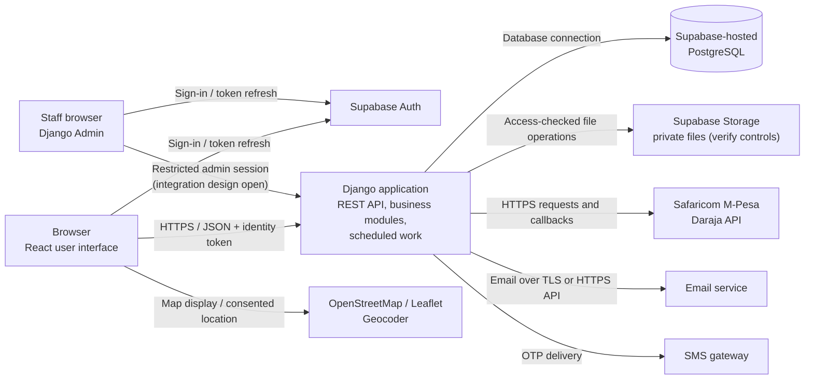
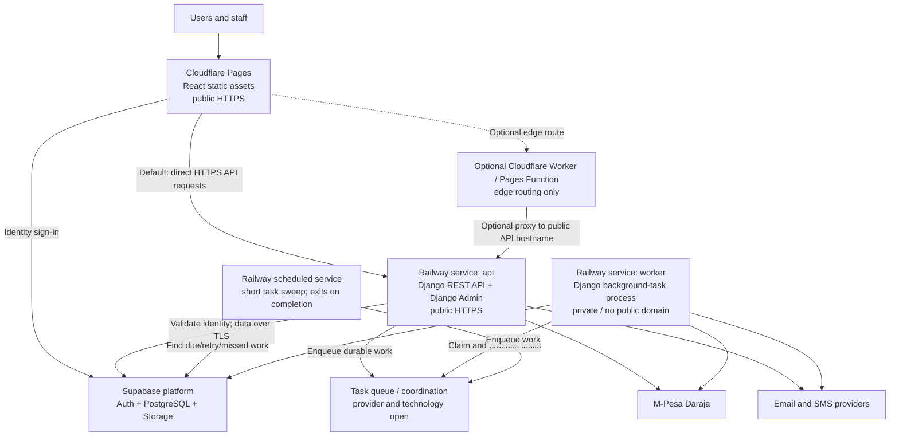

# Kazi Connect System Design Document

**Status:** Working draft  
**Version:** 0.1  
**Source:** [Kazi Connect SRS](./Kazi_Connect_SRS.docx)  
**Design target:** Production  

## 1. Purpose and scope

This document describes how Kazi Connect is intended to be built to satisfy its Software Requirements Specification (SRS). The SRS describes the required behavior; this document records the proposed software structure, technology choices, and design decisions.

This is a working design. Choices marked **Open** need confirmation before implementation or production launch. The SRS's functional requirements and constraints remain authoritative.

## 2. Design summary

Kazi Connect will use a browser-based React client, a Python API built with Django REST Framework, and a Supabase-hosted PostgreSQL database. The application will initially be a **modular monolith**: one Django application divided into business modules, rather than multiple independently deployed services. Django Admin will be the primary staff interface.

The browser will use Supabase Auth for identity and call the Django API for application data and actions. Staff will also use Supabase Auth; a secure integration must establish or validate a restricted Django Admin session. Django-managed PostgreSQL records will store each app profile and its Kazi Connect roles, linked to the corresponding Supabase Auth user ID. Django will own business rules, authorization, payment integration, and database writes. Supabase PostgreSQL will store application data. Supabase Storage is preferred for files, subject to verification against the SRS security and retention requirements. Supabase Realtime has not been selected.

### 2.1 Logical architecture

The diagram shows the intended responsibility boundaries, not the final hosting topology. Hosting and the exact chat transport are still open. Supabase Storage is preferred for files, but its controls must be verified before launch.

### 2.2 Why this architecture?

- **React** implements the responsive browser experience for clients and providers.
- **Django REST Framework** provides a structured API and Django's built-in staff administration capabilities.
- **Supabase Auth** provides user identity; Django validates identity tokens and applies Kazi Connect authorization using server-side application records.
- **PostgreSQL** fits the SRS's relational entities and transactional requirements, especially payment and ledger records.
- A **modular monolith** keeps the first production implementation simpler to build and operate while preserving clear boundaries between accounts, listings, bookings, payments, chat, disputes, and administration.
- Keeping privileged integrations and business rules on the backend prevents browser code from containing payment credentials or becoming the authority for access decisions.

## 3. Technology choices

| Area | Choice | Status and rationale |
|---|---|---|
| Web interface | React; Cloudflare Pages proposed for static deployment | React is the selected frontend; Pages is a deployment option to confirm. |
| Backend language | Python | Confirmed by project owner. |
| Backend framework | Django REST Framework | Confirmed by project owner after comparing Django REST Framework and FastAPI; supports an API and Django Admin. |
| Staff console | Customized Django Admin | Confirmed as the primary admin interface. SRS-required queues, dashboards, reports, and audit views must be checked against this choice. |
| Relational database | PostgreSQL hosted by Supabase | Confirmed by project owner. Django will connect to the hosted database. |
| Identity provider | Supabase Auth | Confirmed by project owner; Django will validate identity tokens. |
| Application profiles and roles | Django-managed PostgreSQL records linked to Supabase Auth user IDs | Confirmed by project owner; credentials and identity are separate from application roles and profile data. |
| Django Admin staff sign-in | Supabase Auth with a secure Django Admin integration | Confirmed by project owner; the integration and session details remain open. |
| File/object storage | Supabase Storage preferred | Confirmed as the preferred direction; verify encryption at rest, private access, expiring links, and retention/deletion controls before relying on it. |
| Supabase Realtime | Not selected | Chat still requires a designed WSS and HTTPS polling solution. |
| Chat transport | Secure WebSocket (WSS), with HTTPS polling fallback | Required by SRS; implementation choice is open. |
| Background jobs and scheduler | Open | Needed for timed payment release, reverification reminders, retention/deletion work, and retries. |
| Hosting and deployment platform | Hybrid proposal: Cloudflare Pages for the static frontend; Railway for Django services | Final platform choice, Cloudflare product configuration, and production plan need confirmation. |

## 4. Application responsibilities

The Django application is divided into modules with explicit business responsibilities. Modules may share one deployment and database while keeping their rules separate.

| Module | Main responsibility | SRS examples |
|---|---|---|
| Accounts and access | Registration, sign-in, verification, roles, sessions, provider upgrade | ACC requirements |
| Profiles and verification | Client/provider profiles, student status, badge applications, document decisions | Profile and verification requirements |
| Categories and listings | Categories, price guidance, service listings, search criteria | Listing and search requirements |
| Bookings | Booking lifecycle, state transitions, cancellation, confirmation | Booking requirements and lifecycle |
| Payments and ledger | Daraja payments, provider payouts, refunds, commissions, immutable money movements | Payment and ledger requirements |
| Messaging | Conversations, messages, reporting, rate limits, access checks | Chat and safety requirements |
| Disputes and reviews | Evidence, decisions, outcomes, ratings, reviews | Dispute and review requirements |
| Notifications | Email/SMS delivery status and user notifications | Notification requirements |
| Administration and audit | Staff workflows, settings, exports, append-only audit events | Admin and audit requirements |
| Privacy and retention | Consent, data export/deletion, retention and anonymization jobs | Privacy and data-rights requirements |

## 5. Data design

### 5.1 Identity and application records

Supabase Auth owns the authentication identity and credentials. Django-managed PostgreSQL records hold the Kazi Connect profile, account status, roles, and domain data. Each application profile links to the corresponding Supabase Auth user ID. Django must not treat client-provided role values or editable identity metadata as authorization.

The SRS requires password hashes to use Argon2id or bcrypt. Before launch, verify that the selected Supabase Auth configuration satisfies this requirement. Do not duplicate password hashes in the application profile table.

### 5.2 Domain entities

The following entities come from the SRS data requirements. The relationships below describe the intended domain ownership; exact fields, cardinalities, and constraints should be checked against Figure 7 and the detailed requirements before implementation.

| Entity | Purpose and key design notes |
|---|---|
| User profile | Kazi Connect account linked to a Supabase Auth user ID; stores app-specific identity/contact data, roles, active mode, category, and status. Credentials remain with Supabase Auth. |
| Student verification | Verified student email and its verification/expiry dates; associated with an account. |
| Provider profile | Provider-specific information for an upgraded account, including payout number, experience, and recommendation score. |
| Badge application | Verification request, fee receipt, document references, status, and decision; associated with an applicant and admin decision. |
| Service category | Category settings, estimate range, price limits, job rules, and higher-risk flag. |
| Listing | Service offered by a provider, with price, unit, service area, and status. |
| Booking | Request for a listing, with client/provider, schedule, location, price, commission snapshot, and lifecycle state. |
| Payment | M-Pesa STK Push collection with receipt number and status; associated with a booking or badge fee. |
| Transfer | Daraja B2C payout to a provider or refund to a client, including result details. |
| Ledger entry | Immutable money-movement record associated with a booking or badge fee. |
| Dispute | Booking-related reason, evidence references, responses, outcome, and decision. |
| Review | Rating and comment by one party to a booking about the other party. |
| Conversation and message | Conversation between a client and provider and its messages, with sender and access-control data. |
| Report | User report about a user, listing, message, or review, with handling status. |
| Notification | Email notification record and delivery status, associated with its recipient. |
| Setting | Configurable value, such as a commission rate or time limit, with change history. |
| Audit log | Append-only record of sensitive actions, including actor, action, time, and relevant before/after values. |

### 5.3 Data integrity and retention

- Booking records preserve the price and commission rate that applied when the booking was made; later setting changes must not silently alter existing bookings.
- Payment and ledger changes must be transactional. Ledger entries and audit records are append-only; corrections are represented by new records rather than editing historical entries.
- Sensitive-file records keep references and lifecycle metadata; the files themselves remain in private object storage and are accessible only after an application authorization check.
- Retention and deletion jobs must enforce the SRS periods:

| Data | SRS retention period |
|---|---|
| Identity document images | 30 days after the badge decision |
| Badge decision records | While the account exists, plus 12 months |
| Chat messages | 12 months after the last booking between the parties |
| Payment, transfer, and ledger records | 5 years, or the period required by tax law |
| Dispute records and evidence | 2 years after the decision |
| Audit log | At least 12 months |
| Account data after a deletion request | Deleted or anonymized within 30 days, except financial records |

The complete schema, indexes, uniqueness rules, and deletion/anonymization behavior remain to be detailed and verified against the SRS.

## 6. Key interaction and data-flow rules

1. The React client uses Supabase Auth for sign-in and sends the resulting identity token with application requests to the Django REST API over HTTPS using JSON.
2. Django validates each token, links its Supabase Auth user ID to a Django-managed application profile, and resolves Kazi Connect roles from those server-side records. The backend enforces role-based access, validates input, and applies business rules before accessing data. Client-provided role claims or editable metadata are not authoritative.
3. Django Admin staff identity must be mapped to a server-side staff account with explicit admin privileges. The integration must enforce the SRS's 15-minute admin inactivity timeout; details are open.
4. The backend is the trusted caller for Daraja, email, and SMS services. Provider credentials and other secrets are held only in server-side environment configuration or a secrets manager.
5. Payment and ledger changes are written transactionally. The browser must not determine whether a payment succeeded or whether funds can be released; verified provider responses and backend rules determine state.
6. Staff actions use Django Admin and must be authorized and audited. Sensitive document access must also be audited.
7. Sensitive files are not public. Django checks authorization before providing access through private Supabase Storage; access links expire within the SRS's five-minute limit. Storage encryption, signed-link behavior, and deletion/retention controls must be verified before launch.
8. All timestamps are stored in UTC and displayed in East Africa Time (UTC+3).

The detailed authentication sequence, complete relational schema, booking and payment flows, error handling, and idempotency rules remain to be specified.

## 7. Production quality and security constraints

The design must preserve the SRS's measurable constraints:

- HTTPS with TLS 1.2 or higher; role-based authorization on every API endpoint.
- User sessions expire after 30 minutes of inactivity; admin sessions after 15 minutes.
- Passwords use Argon2id or bcrypt. Sign-in, OTP, search, and messaging endpoints are rate-limited.
- Identity documents and evidence files are encrypted at rest and served only through access-checked links that expire after five minutes.
- Uploads are checked for permitted type and size before storage. Secrets are never shipped to the React application.
- Payment, ledger, and dispute decisions must not be lost; ledger writes use database transactions.
- Database backups are daily and retained for 30 days; target RPO is 24 hours and target RTO is 8 hours.
- Monthly pilot availability target is 99%. Application servers should be stateless so instances can scale horizontally.
- Audit records are append-only and retained for at least 12 months. Audit coverage includes staff actions, identity-document access, chat-history access, booking state changes, and ledger entries.
- Personal data follows the SRS retention periods and the Data Protection Act, 2019. A data protection impact assessment and required registration are launch prerequisites identified by the SRS.
- The REST API is documented in OpenAPI format. Automated tests should cover at least 70% of booking, payment, dispute, and ledger code.

These are design constraints, not claims that the selected hosting or storage services already satisfy them. Provider capabilities and configuration must be verified during deployment design.

## 8. Proposed Cloudflare and Railway deployment architecture

The React frontend can be built into static assets and served from **Cloudflare Pages**. Railway remains the proposed host for the Python/Django processes because they need a conventional persistent web process and background worker. Keep Django as one modular monolith while deploying its API and worker as separate Railway services with different start commands.

Cloudflare **Workers** are a separate edge-compute product, not the same thing as Railway's background `worker` service. A Worker or Pages Function is optional: add one only for a concrete edge requirement such as request normalization or a carefully designed proxy. It should not duplicate Kazi Connect authorization, payment, booking, or other authoritative business rules. Pages Functions execute on the Workers platform; the static React site does not need a Worker just to serve assets.

Railway calls a deployable container a **service**. A Railway service can run continuously or as a scheduled job.

### 8.1 Services and process boundaries

| Platform service | Process | Exposure and scaling |
|---|---|---|
| Cloudflare Pages `frontend` | Build the React app into static files and serve them through Cloudflare's global network. | Public HTTPS. Browser calls Django at its public HTTPS API hostname and Supabase Auth. Configure SPA fallback/routing and exact allowed frontend origins. |
| Optional Cloudflare Worker / Pages Function | Small edge handler, if a concrete use case justifies it. | Public edge entry point if used as a proxy. It must forward to the Railway API's public hostname; Railway private networking does not extend to Cloudflare. Keep authorization and business decisions in Django. |
| Railway `api` | Django REST API and Django Admin in the same web process/deployment. | Public HTTPS for browser traffic, staff access, optional edge proxy, and Daraja callbacks. Listen on Railway's injected `PORT`; expose a readiness endpoint for deploy health checks. Add replicas only after ensuring sessions, database connections, and shared state work across replicas. |
| Railway `worker` | Background task consumer using the same backend source/image but a different start command from the API. | No public domain required. Scale separately from the API. Use idempotent task handlers and durable task state so work can be retried safely. |
| Railway `scheduler` | Optional short-lived scheduled command that finds due or missed work and queues it, then exits. | Railway Cron can suit periodic sweeps, not a continuously running process or precise timer. Cron schedules use UTC, must be at least five minutes apart, and an overlapping prior run can cause a scheduled run to be skipped. |
| Queue | Optional message broker/coordination service if selected by the background-job design. | Internal to Railway services if hosted there. Choice (for example, managed Redis versus a PostgreSQL-backed approach) remains open; it must not replace PostgreSQL as the source of truth for bookings, payments, and ledger entries. |

The API and Railway worker can use the same backend Docker image with different start commands. A frontend/backend monorepo can deploy the React directory to Pages and the backend directory to Railway independently, using separate build settings and watch paths so frontend-only changes need not rebuild Django.

### 8.2 Request and data paths

- Users load the React app from Cloudflare Pages. The browser signs in with Supabase Auth and sends identity tokens to the public Django API, directly or through an optional Worker. Configure Django's allowed CORS origins for the exact Pages/custom domains; a proxy does not replace API authentication or authorization.
- Django Admin is served by the same Django API service, behind the Supabase Auth-to-admin integration and server-side staff-role checks described earlier. This avoids creating a separate admin application/container.
- The Django API receives the Daraja callback at a public HTTPS endpoint. It validates the callback and records payment state transactionally; asynchronous follow-up work can be handed to the worker.
- API, Railway worker, and scheduled task services connect to Supabase Auth, PostgreSQL, and Storage using server-side credentials and TLS. Railway private networking only connects services within the Railway project/environment; it does not make Cloudflare or Supabase part of that private network.
- Use Railway-managed environment variables/secrets per environment. Never put Supabase service-role credentials, Daraja secrets, SMS credentials, or email credentials in the React build or public variables.
- Run schema migrations as a controlled, single deployment step before the new API version receives traffic; do not run migrations concurrently from every API replica.

### 8.3 State, resilience, and deployment

- Keep Railway application containers and Cloudflare edge handlers stateless. Do not store uploaded evidence, user files, or authoritative application data on a container or edge instance filesystem.
- Store relational state and durable job intent in Supabase PostgreSQL; store private uploads in the selected Supabase Storage buckets after verifying the SRS controls. Railway volumes are not required for the proposed application topology.
- The API health check should report readiness for deployment startup. Railway uses health checks during deployment switching, but does not continuously monitor that endpoint after deployment, so add external uptime/alerting.
- Ensure delayed work is recoverable: persist each job's due time/status, make processing idempotent, and run a periodic catch-up sweep after restarts or missed executions. A Railway Cron run by itself is not a precise 48-hour timer.
- Use separate Railway environments for development/staging and production, each with its own secrets and service configuration. Verify Railway's and Supabase's backup, restore, availability, and regional capabilities against the SRS RPO/RTO and availability objectives.

This is a proposed hybrid deployment mapping, not yet a final production topology. Confirm Cloudflare Pages versus the newer Workers static-assets model, whether an edge Worker is needed at all, Railway service count, queue technology, regions, scaling limits, deployment/rollback strategy, and cost before launch.

Platform references: Railway [Services](https://docs.railway.com/services), [Deploying a Monorepo](https://docs.railway.com/deployments/monorepo), [Private Networking](https://docs.railway.com/networking/private-networking), [Cron Jobs](https://docs.railway.com/cron-jobs), and [Healthchecks](https://docs.railway.com/deployments/healthchecks); Cloudflare [Pages](https://developers.cloudflare.com/pages/), [Workers](https://developers.cloudflare.com/workers/), and [Pages Functions](https://developers.cloudflare.com/pages/functions/). Cloudflare currently describes Workers as its primary platform for new projects, while Pages remains an option for static sites.

## 9. Open design decisions

| ID | Decision needed | Why it matters |
|---|---|---|
| D-01 | How will the Supabase Auth staff identity be mapped to Django Admin privileges and a session that enforces the 15-minute inactivity timeout? | Django Admin needs a secure integration; a normal user token must never imply staff access. |
| D-02 | Does the selected Supabase Storage configuration satisfy the SRS's encryption, private-access, expiring-link, and retention/deletion requirements? | These controls must be verified before sensitive documents are stored there in production. |
| D-03 | How will chat deliver WSS and provide the required HTTPS polling fallback? | Determines the realtime component, deployment, and authorization design. |
| D-04 | Which worker/queue and scheduler will run auto-release, retries, reverification reminders, and retention jobs? | Railway Cron is suitable only for periodic, short, recoverable sweeps; the task queue and durable execution design remain to be chosen. |
| D-05 | Confirm the Cloudflare Pages + Railway hybrid, decide whether any Cloudflare Worker is needed, and select regions/environment plans. | Needed to validate frontend/API routing, networking, secrets, scaling, monitoring, backups, recovery, and service limits against the SRS. |
| D-06 | Can customized Django Admin meet every SRS admin-console workflow, including dashboards, queues, evidence review, audit, and CSV export? | A mismatch may require custom Django views or a separate admin UI. |

## 10. Next sections to design

1. Authentication and authorization flows, especially the Django Admin staff integration and session timeouts.
2. Entity relationships, complete schema, indexes, and constraints.
3. Booking lifecycle, payment/ledger transactions, Daraja callbacks, retries, and idempotency.
4. File storage, chat, notifications, and scheduled jobs.
5. Finalize Cloudflare and Railway configuration, deployment/rollback, monitoring, backups, recovery, and requirements traceability.
